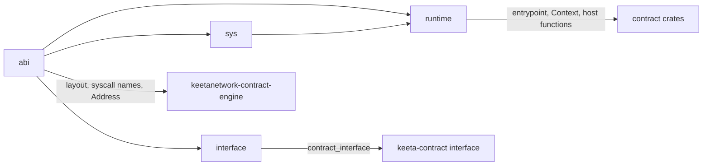

# Contract Std

## Abstract

This page is the internal design of `keetanetwork-contract-std`. The crate is two things at once. It is the Rust SDK that contracts build against, and it is the one definition of the binary interface between a contract and `keetanetwork-contract-engine`. The page states which module owns which side, and which invariants tie the crate to the engine.

## Purpose

An engineer reads this page before changing the contract input layout, adding a host function, or changing how the SDK builds on and off chain. After reading, the engineer knows which module to change, which engine code must change with it, and which test proves the two still agree.

## Internal design

`abi` owns everything both sides must agree on. That covers the input layout and its offsets (`layout`), the memory map (`HEAP_START`, `HEAP_SIZE`, `INPUT_START`), the limits, `Address`, `StateId`, the host function names (`syscall`), and `syscall_hash`. The engine builds against this module too, so the layout is defined once. `abi` has no dependency on the target and compiles the same on and off chain.

`sys` owns the raw host function calls. On chain, each call is a function pointer whose value is the `syscall_hash` of the host function's name. sBPF v3 turns a call to that constant into a host function call. Off chain, each call panics, so contracts still compile for tests, docs and lints. `sys` is private.

`runtime` owns what a contract sees. `Context::from_input` reads the input region the engine mapped. `Account` reads and writes account data in place. The safe host function wrappers (`send`, `invoke`, `set_return_data` and the rest) sit on top of `sys`. `entrypoint!` expands to the exported `entrypoint` symbol, the `BumpAllocator` global allocator, and the `custom_panic` hook that reports a panic through `syscall::ERROR`.

`interface` owns the off-chain description of a contract (`Interface`, `Seed`) and its `keeta-contract-interface` JSON. It exists only with feature `borsh` on a target other than `target_os = "solana"`.

## Invariants shared with the engine

| Invariant | Where each side lives | What enforces it |
| --- | --- | --- |
| The engine writes the input with the `layout` offsets and the SDK reads it with the same offsets. | `Context::from_input` in `src/runtime.rs`, and the input builder in `keetanetwork-contract-engine/src/vm.rs` | Every end-to-end test in `keetanetwork-contract-engine/tests/contracts.rs` |
| Every name in `syscall::ALL` and `syscall::PLATFORM` is registered as a host function. | `src/abi.rs`, and `register_host_functions` in `keetanetwork-contract-engine/src/vm.rs` | The engine's loader sets `reject_unregistered_static_syscalls`, so `Engine::store_code` refuses code that calls any other hash |
| `syscall_hash` equals the sBPF loader's own symbol hash, Murmur3 with seed 0. | `syscall_hash` in `src/abi.rs`, and `solana-sbpf` | `hashes_match_the_sbpf_loader` in `src/abi.rs` |
| `BumpAllocator` keeps its position in the first word of the heap and treats `0` as an empty heap. | `src/runtime.rs`, and the zero-filled heap in `keetanetwork-contract-engine/src/vm.rs` | sBPF programs cannot have writable statics, so the heap is the only place for the position |
| The SDK's account checks only produce clear errors. The engine decides which accounts may change. | `Account::check_mutable` in `src/runtime.rs`, and `flush_accounts` in `keetanetwork-contract-engine/src/vm.rs` | `contracts_change_only_their_own_writable_accounts` in `keetanetwork-contract-engine/tests/contracts.rs` |
| Off chain, `sha256` and `state_id` compute the same ids as the engine's `state_id`. | `src/runtime.rs`, and `state_id` in `keetanetwork-contract-engine/src/engine.rs` | The engine tests name accounts with the example contracts' helpers, built for the host |

## Collaboration

Inbound: `borsh` is an optional dependency behind feature `borsh`. `sha2` is a dependency only on targets other than `target_os = "solana"`.

Outbound: `keetanetwork-contract-engine` depends on this crate for `abi`. Contract crates depend on it by path, as the examples in `keetanetwork-contract-engine/tests/contracts` do. The `keeta-contract interface` command in anchor-contracts builds a contract for the host and calls its `contract_interface` function. Contracts in other languages depend on no crate at all, and follow `abi` by hand, as [Contracts in other languages](../../docs/concepts/CONTRACTS-IN-OTHER-LANGUAGES.md) describes.

## Feature and build contract

The crate has no default features. Feature `borsh` adds borsh encoding for `Address`, `Account::load` and `Account::store`, and, off chain, the `interface` module with borsh's `unstable__schema` feature.

On chain means `target_os = "solana"`, which the `sbpfv3-solana-solana` target sets. There, `sys` calls host functions, `sha256` calls `syscall::SHA256`, and `entrypoint!` emits the entrypoint, the allocator and the panic hook. On any other target, `sys` panics, `sha256` uses `sha2`, and `entrypoint!` only checks the signature of `process`. The on-chain program never depends on `sha2` or borsh's schema code.

## Falsified by

A change to the input layout, the memory map or the limits in `src/abi.rs`. A host function added to, renamed in, or removed from `syscall` or `register_host_functions`. A change to how `BumpAllocator` keeps its position, or to the engine's heap setup. A change to the `borsh` feature or to the `target_os = "solana"` split in `Cargo.toml`. A move of the contract interface out of this crate.
